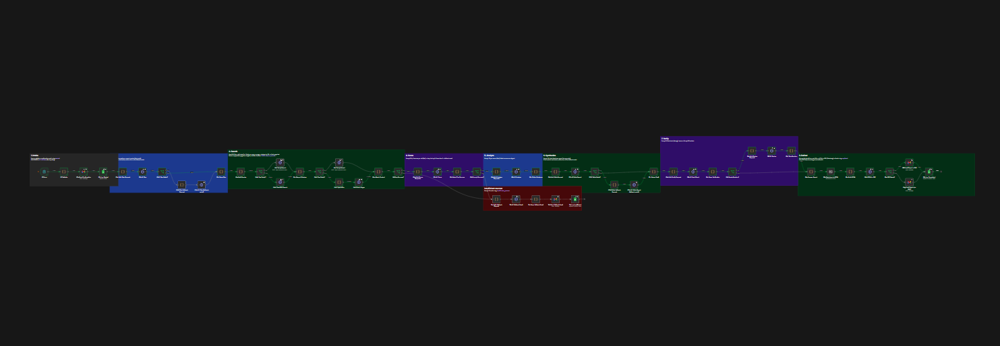
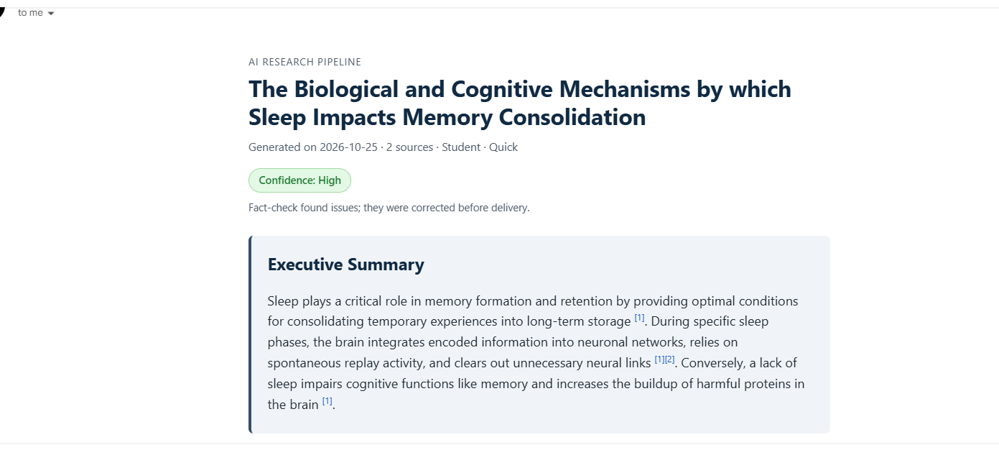
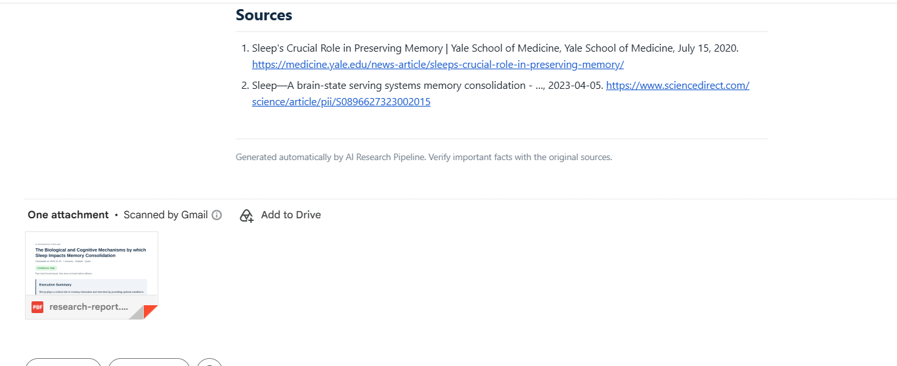
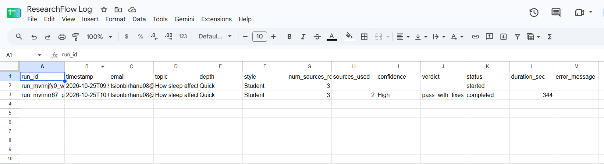
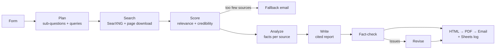

# ResearchFlow AI

**An n8n pipeline that turns a research question into a cited, fact-checked report, delivered by email with a PDF, and it runs entirely on free tools.**

You submit a topic through a web form. A few minutes later a report arrives in your inbox: every claim is cited, a second AI pass has fact-checked it, and the run is logged to Google Sheets.



## What you get

| Report email | Real sources + PDF attachment |
|---|---|
|  |  |

Every run is logged:



## How it works



| # | Stage | What happens |
|---|---|---|
| 1 | **Intake** | Form, validation, confirmation email, `started` row in Google Sheets |
| 2 | **Plan** | AI turns the topic into sub-questions and 3 to 5 search queries |
| 3 | **Search** | SearXNG searches the web, results are deduped, pages are downloaded and cleaned |
| 4 | **Score** | AI rates sources for relevance, credibility and recency (5 per call) and keeps the best |
| 5 | **Analyze** | AI extracts facts, statistics and short quotes from each source |
| 6 | **Write** | AI writes the report using only those facts, with `[n]` citations |
| 7 | **Verify** | A second AI pass fact-checks the draft; flagged claims are fixed or removed |
| 8 | **Deliver** | Styled HTML email + PDF, and the Sheets row is updated to `completed` |
| 9 | **Errors** | A separate error workflow emails the user in plain language and logs `failed` |

## Highlights

- **Free to run.** Google Gemini free tier, with n8n, SearXNG (search) and Gotenberg (PDF) self-hosted in Docker. No credit card anywhere.
- **No invented sources.** The Sources list is rebuilt from the real search results; citations to sources that don't exist are removed.
- **Fact-checked.** A verification pass flags unsupported or mis-cited claims, and a reviser corrects them before delivery.
- **Honest about uncertainty.** Each report carries a High / Medium / Low confidence badge and a limitations section.
- **Built to fail gracefully.** Broken or paywalled pages are skipped. If the AI model is overloaded, the run falls back to another model. If the PDF fails, the email still goes out. Thin results trigger a "try a broader topic" email.
- **Configurable.** Depth (Quick / Standard / Deep), audience (Student / Business / Technical), language, number of sources and source age.
- **One-command setup and tested.** `npm run setup` configures n8n for you, and 26 automated tests cover every code step.

## Tech stack

| Part | Tool |
|---|---|
| Workflow engine | [n8n](https://n8n.io), self-hosted |
| AI model | [Google Gemini](https://aistudio.google.com) free tier (OpenAI-compatible endpoint). Claude API supported as an option |
| Web search | [SearXNG](https://docs.searxng.org), self-hosted |
| PDF | [Gotenberg](https://gotenberg.dev), self-hosted |
| Email and logging | Gmail, Google Sheets |
| Runtime | Docker Compose, Node.js (build, tests, setup) |

## Quick start

You need [Docker Desktop](https://www.docker.com/products/docker-desktop/) and [Node.js](https://nodejs.org) 18+.

```bash
git clone https://github.com/tsionbirhanu/researchflow-ai.git
cd researchflow-ai
docker compose up -d          # starts n8n, SearXNG and Gotenberg
```

1. Open <http://localhost:5678>, create your n8n account, and create an API key (**Settings → n8n API**).
2. Get a free Gemini key at [aistudio.google.com](https://aistudio.google.com).
3. Create a Google OAuth client and a Google Sheet with a `runs` tab and the log headers.
4. Copy `.env.example` to `.env` and fill in the five values.
5. Run:
   ```bash
   npm run setup
   ```
6. In n8n, click **Sign in with Google** on the *Google Sheets* and *Gmail* credentials.
7. Open the workflow, run `01 Form` → **Test step**, and submit a topic.

Step-by-step instructions, including the Google setup and troubleshooting, are in **[docs/setup.md](docs/setup.md)**.

## Project structure

```
researchflow-ai/
├── workflows/        # Importable n8n workflows (generated by the build script)
├── code/
│   ├── nodes/        # Source of every n8n Code node
│   └── lib/          # Shared helpers (AI request builder, JSON parsing, HTML to text)
├── prompts/          # The AI prompts, one file per step
├── templates/        # HTML report template (email body and PDF)
├── schemas/          # JSON shapes returned by each AI step
├── scripts/
│   ├── build-workflow.js   # Builds workflows/*.json from code, prompts and template
│   ├── setup-n8n.js        # One-command n8n setup via the n8n API
│   └── test-nodes.js       # Tests every Code node with mocked n8n data
├── searxng/          # Search engine settings
├── docs/             # Setup guide and screenshots
├── docker-compose.yml
└── .env.example
```

## Development

The workflow JSON is generated, so change the source files instead of editing it:

```bash
npm run build    # rebuild workflows/*.json from code/, prompts/ and templates/
npm test         # run the tests (no keys needed)
npm run setup    # push the new version into your local n8n
```

## Limitations

- On the free tier, Gemini has per-minute and daily limits, so runs take a few minutes and the number of reports per day is capped.
- Report quality depends on what the search engines return; niche topics can produce thin evidence, and the report says so.
- The fact-check reduces errors but doesn't remove them. Verify important facts against the linked sources.
- Self-hosted on a laptop, the form works only while Docker is running and only on that machine unless you expose it.
