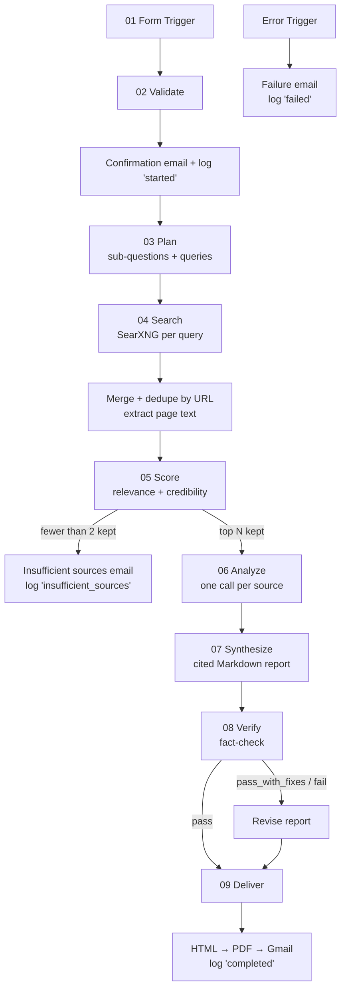

# ResearchFlow AI: AI Research Pipeline v2

An n8n automation that turns a web-form research request into a cited, fact-checked report, delivered by email as an HTML body with a PDF attachment.

Submit a topic and the pipeline plans the research, searches the web, scores every source for relevance and credibility, extracts evidence, writes a report in which every claim carries a citation, fact-checks the draft against the sources, and logs each run to Google Sheets.

## Features

- **Research planning:** the topic is broken into sub-questions and targeted search queries.
- **Source scoring:** each source is rated for relevance, credibility and recency, and only the top N are kept.
- **Evidence-only writing:** the report uses only facts pulled from the analyzed sources, with `[n]` citations.
- **Fact-check pass:** a second model flags unsupported, mis-cited or exaggerated claims, and a reviser fixes them.
- **Real source list:** the Sources section is rebuilt from the actual search results, and citations to non-existent sources are removed.
- **Configurable output:** depth (Quick / Standard / Deep), audience style (Student / Business / Technical), language and source age limit.
- **Delivery:** HTML email plus PDF attachment.
- **Observability:** every run is logged to Google Sheets with its status, confidence, verdict and duration.
- **Graceful failure:** broken or paywalled URLs are skipped, thin results trigger a fallback email, and pipeline errors send the user a plain-language failure email.

## Architecture



### Pipeline stages

| # | Stage | What happens | Prompt | Model |
|---|---|---|---|---|
| 1 | Intake | Form Trigger, validation, confirmation email, `started` row in Sheets | fixed template ([08](prompts/08-confirmation-email.md) as reference) | n/a |
| 2 | Plan | Generates sub-questions and 3 to 5 search queries as JSON | [01](prompts/01-research-planner.md) | fast |
| 3 | Search | SearXNG (or Tavily) search per query, merge, dedupe by URL, download page text | n/a | n/a |
| 4 | Score | Rates sources 5 per call and keeps the top `num_sources` (max 10) | [02b](prompts/02b-source-scorer-batch.md), [10](prompts/10-insufficient-sources-fallback.md) | fast |
| 5 | Analyze | Extracts facts, statistics, quotes and metadata per source | [03](prompts/03-source-analyzer.md) | fast |
| 6 | Synthesize | Writes the Markdown report from the extracted evidence only | [04](prompts/04-report-writer.md) | strong |
| 7 | Verify | Fact-checks the draft, assigns confidence, and revises if needed | [05](prompts/05-fact-checker.md), [06](prompts/06-report-reviser.md) | strong |
| 8 | Deliver | Markdown → HTML ([template](templates/report.html)) → PDF → Gmail, row updated to `completed` | [07](prompts/07-html-report-template.md) as design spec | n/a |
| 9 | Error | Error Trigger sends a failure email and logs a `failed` row | [09](prompts/09-failure-email.md) | fast |

The AI provider is set in the `CONFIG` block of `02 Validate`. The default is **Google Gemini's free tier** (`gemini-flash-lite-latest` for fast steps, `gemini-flash-latest` for strong ones) through its OpenAI-compatible endpoint. Any other OpenAI-compatible provider works, and so does the Claude API (`claude-haiku-5-5` / `claude-sonnet-5-5`) with a one-line change.

### Design principles

- **JSON between stages.** Every AI step that feeds another node returns strict JSON, parsed defensively (text blocks only, fences stripped). Shapes are documented in [`schemas/`](schemas/).
- **No hallucinated sources.** The writer, fact-checker and reviser see only the analyzed evidence. URLs and titles always come from the search results, never from the model.
- **Runs for free.** Gemini free tier, plus n8n, SearXNG and Gotenberg self-hosted with Docker. Sources are scored 5 per call and per-source calls are spaced 12 seconds apart to fit free-tier rate limits.
- **Cost control.** Sources are capped at 10 and candidates at 10. A fast model handles planning, scoring and analysis, and a stronger model handles writing and verification.
- **Provider-aware settings.** OpenAI-compatible providers get low temperatures (0 to 0.4). The Claude API version `2026-10-21` rejects sampling parameters, so Claude calls set `output_config.effort` instead.
- **Resilience.** Every HTTP and AI node retries 3 times. Per-source calls continue on failure and the source is skipped. If the fact-check itself fails, the report is delivered marked "unverified" with Low confidence. If the PDF fails, the email is sent without it.

## Tech stack

| Concern | Tool |
|---|---|
| Orchestration | [n8n](https://n8n.io), self-hosted with Docker (free) |
| LLM | [Google Gemini](https://aistudio.google.com) free tier by default; any OpenAI-compatible API or the [Claude API](https://docs.anthropic.com) |
| Web search | [SearXNG](https://docs.searxng.org), self-hosted in Docker (free, no key); [Tavily](https://tavily.com) optional |
| Logging | Google Sheets |
| Email | Gmail |
| PDF rendering | [Gotenberg](https://gotenberg.dev), in the same Docker setup |

## Repository structure

```
researchflow-ai/
├── workflows/          # Importable n8n workflows (generated; do not edit by hand)
│   ├── research-pipeline.json
│   └── error-handler.json
├── code/
│   ├── nodes/          # Source of every n8n Code node, one file per node
│   ├── lib/helpers.js  # Shared helpers injected into every Code node
│   └── parse-ai-json.js# Standalone JSON-parse snippet for manual builds
├── prompts/            # The 10 AI prompts, one file each (injected at build time)
├── templates/          # HTML report template (email body + PDF)
├── schemas/            # JSON shapes for planner, scorer, analyzer and verifier output
├── scripts/
│   ├── build-workflow.js  # Assembles workflows/*.json from the sources above
│   ├── test-nodes.js      # Runs every Code node against mocked n8n data
│   └── setup-n8n.js       # One-command setup: credentials + workflows via the n8n API
├── docs/               # Setup guide, Sheets log spec, testing checklist
├── samples/            # Sample reports for demos
├── docker-compose.yml  # Free local n8n + SearXNG + Gotenberg
├── searxng/            # SearXNG settings (JSON output enabled)
├── .env.example        # Keys and settings reference (no real values)
├── CLAUDE.md           # Full project spec and working rules
└── README.md
```

## Quick start (free)

1. **Start the stack:** `docker compose up -d`, then open <http://localhost:5678>.
2. **Get a free Gemini key** from [AI Studio](https://aistudio.google.com). No card needed. Web search (SearXNG) needs no key.
3. **Create a Google OAuth client** and the log sheet (columns in [`docs/google-sheets-log.md`](docs/google-sheets-log.md), tab named `runs`).
4. **Fill in `.env`** (copy `.env.example`): n8n API key, Gemini key, Google Client ID and secret, Sheet ID.
5. **Run `npm run setup`.** It creates the credentials, imports both workflows with everything attached, and links the error workflow.
6. In n8n, **Sign in with Google** on the Google Sheets and Gmail credentials, test the form with Quick depth and 3 sources, then **activate**.

Full walkthrough, including the free Google OAuth setup and troubleshooting: [`docs/setup.md`](docs/setup.md).

## Development

The JSON in `workflows/` is generated. To change the pipeline, edit the sources and rebuild:

```bash
# edit prompts/*.md, code/nodes/*.js, code/lib/helpers.js or templates/report.html
npm run build   # regenerates workflows/*.json and syntax-checks every Code node
npm test        # runs every Code node against mocked n8n data (no keys needed)
```

Then re-import the workflow in n8n (credentials need to be selected again after a re-import).

## Form inputs

| Field | Type | Required | Values |
|---|---|---|---|
| Topic | text | yes | free text |
| Specific question | textarea | no | free text |
| Number of sources | dropdown | yes | 3 / 5 / 8 / 10 |
| Depth | dropdown | yes | Quick / Standard / Deep |
| Style | dropdown | yes | Student / Business / Technical |
| Language | dropdown | no | English (default) / Spanish / French / German / Portuguese / Arabic / Chinese |
| Max source age (years) | number | no | e.g. 1, 3, 5 |
| Email | email | yes | valid email |

## Run statuses

`started` → `completed` on success, `insufficient_sources` when fewer than 2 sources survive scoring, and `failed` when any stage errors.

## Limitations

- Report quality depends on what the search engines return. Niche or very recent topics may produce thin evidence, and the report says so.
- The fact-checker reduces but does not remove the risk of errors. Verify important facts against the linked sources.
- Paywalled content is skipped, so some authoritative sources may be missing.
- The error handler needs n8n API access to find the user's email; without it, failures are still logged but no email is sent.
- On free tiers, runs are slower (calls are spaced out) and the daily request limit caps how many reports you can make per day.
- Self-hosted on your computer, the form only works while Docker is running, and only on your machine unless you expose it with a tunnel.
