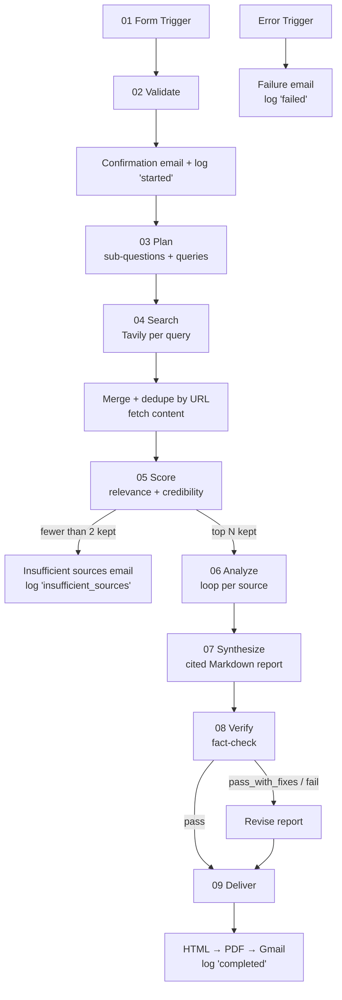

# ResearchFlow AI: AI Research Pipeline v2

An n8n automation that turns a web-form research request into a cited, fact-checked report, delivered by email as an HTML body with a PDF attachment.

Submit a topic and the pipeline plans the research, searches the web, scores every source for relevance and credibility, extracts evidence, writes a report in which every claim carries a citation, fact-checks the draft against the sources, and logs each run to Google Sheets.

## Features

- **Research planning:** the topic is broken into sub-questions and targeted search queries.
- **Source scoring:** each source is rated for relevance and credibility, and only the top N are kept.
- **Evidence-only writing:** the report uses only facts pulled from the analyzed sources, with `[n]` citations.
- **Fact-check pass:** a second model flags unsupported, mis-cited or exaggerated claims, and a reviser fixes them.
- **Configurable output:** depth (Quick / Standard / Deep), audience style (Student / Business / Technical), language and source age limit.
- **Delivery:** HTML email plus PDF attachment.
- **Observability:** every run is logged to Google Sheets with its status, confidence and duration.
- **Graceful failure:** broken or paywalled URLs are skipped, thin results trigger a fallback email, and pipeline errors send the user a plain-language failure email.

## Architecture



### Pipeline stages

| # | Stage | What happens | Prompt | Model |
|---|---|---|---|---|
| 1 | Intake | Form Trigger, validation, confirmation email, `started` row in Sheets | [08](prompts/08-confirmation-email.md) | fast |
| 2 | Plan | Generates sub-questions and 3 to 5 search queries as JSON | [01](prompts/01-research-planner.md) | fast |
| 3 | Search | Tavily search per query, merge, dedupe by URL, extract content | n/a | n/a |
| 4 | Score | Rates each source and keeps the top `num_sources` (max 10) | [02](prompts/02-source-scorer.md), [10](prompts/10-insufficient-sources-fallback.md) | fast |
| 5 | Analyze | Extracts facts, statistics, quotes and metadata per source | [03](prompts/03-source-analyzer.md) | fast |
| 6 | Synthesize | Writes the Markdown report from the extracted evidence only | [04](prompts/04-report-writer.md) | strong |
| 7 | Verify | Fact-checks the draft, assigns confidence, and revises if needed | [05](prompts/05-fact-checker.md), [06](prompts/06-report-reviser.md) | strong |
| 8 | Deliver | Markdown → HTML → PDF → Gmail, row updated to `completed` | [07](prompts/07-html-report-template.md) | strong |
| 9 | Error | Error Trigger sends a failure email and logs a `failed` row | [09](prompts/09-failure-email.md) | fast |

### Design principles

- **JSON between stages.** Every AI step that feeds another node returns strict JSON, parsed with [`code/parse-ai-json.js`](code/parse-ai-json.js). Shapes are documented in [`schemas/`](schemas/).
- **No hallucinated sources.** The writer, fact-checker and reviser see only the analyzed evidence and must never add outside facts, URLs, quotes or authors.
- **Cost control.** Sources are capped at 10. A fast model handles planning, scoring and analysis, and a stronger model handles writing and verification.
- **Effort, not temperature.** Claude API version `2026-10-21` rejects sampling parameters, so each call sets `output_config.effort`: `low` for the fast model, `medium` for writing, `high` for fact-checking.
- **Resilience.** Retry On Fail (2 to 3 tries) is enabled on every HTTP and AI node, and Continue On Fail on per-source fetch nodes.

## Tech stack

| Concern | Tool |
|---|---|
| Orchestration | [n8n](https://n8n.io) (cloud) |
| LLM | [Claude API](https://docs.anthropic.com) |
| Web search and extraction | [Tavily](https://tavily.com) |
| Logging | Google Sheets |
| Email | Gmail |
| PDF rendering | [Gotenberg](https://gotenberg.dev) or another HTML-to-PDF API |

## Repository structure

```
researchflow-ai/
├── prompts/        # The 10 AI prompts, one file each (see prompts/README.md)
├── schemas/        # JSON shapes for planner, scorer, analyzer and verifier output
├── code/           # Reusable n8n Code node snippets
├── workflows/      # Exported n8n workflow JSON
├── templates/      # HTML report / email templates
├── docs/           # Google Sheets log spec, testing checklist
├── samples/        # Sample reports for demos
├── .env.example    # Required keys and settings (no real values)
├── CLAUDE.md       # Full project spec and working rules
└── README.md
```

## Setup

### Prerequisites

- An n8n instance (n8n Cloud or self-hosted)
- A Claude API key from the [Anthropic Console](https://console.anthropic.com)
- A [Tavily](https://app.tavily.com) API key
- A Google account for Sheets and Gmail
- A Gotenberg endpoint or an HTML-to-PDF API key

### 1. Clone and configure

```bash
git clone <your-repo-url> researchflow-ai
cd researchflow-ai
cp .env.example .env    # fill in your values; .env is git-ignored
```

On **n8n Cloud** you cannot set custom environment variables, so put each key in an n8n **Credential** instead and use `.env` only as your local reference. On **self-hosted** n8n you can load `.env` into the n8n process and read values with `{{ $env.VAR_NAME }}`.

### 2. Create n8n credentials

| Credential | Type in n8n | Used by |
|---|---|---|
| Anthropic | Anthropic API (or Header Auth: `x-api-key`) | All AI nodes |
| Tavily | Header Auth: `Authorization: Bearer <key>` | Search and extract HTTP nodes |
| Google Sheets | Google Sheets OAuth2 | Logging nodes |
| Gmail | Gmail OAuth2 | Confirmation, report and failure emails |
| PDF service | Header Auth or none (Gotenberg) | HTML → PDF node |

### 3. Create the log sheet

Create a Google Sheet with the header row in [`docs/google-sheets-log.md`](docs/google-sheets-log.md), then copy its ID from the URL into `GOOGLE_SHEET_ID`.

### 4. Import or build the workflow

- **Import:** in n8n, go to *Workflows → Import from File* and select the JSON in [`workflows/`](workflows/).
- **Build:** follow the stages above, naming nodes `01 Form`, `02 Validate`, `03 Plan` and so on, and grouping each stage under a sticky note.

Then:

1. Paste each prompt from [`prompts/`](prompts/) into its AI node and set the model and temperature listed in the prompt's header.
2. Add a Code node with [`code/parse-ai-json.js`](code/parse-ai-json.js) after every JSON-output AI node.
3. Enable **Retry On Fail** on HTTP and AI nodes, and **Continue On Fail** on per-source fetch nodes.
4. Create a separate error workflow that starts with an **Error Trigger**, and set it under *Workflow Settings → Error Workflow*.

### 5. Test

Activate the workflow, open the Form Trigger's production URL, and submit a request. Work through [`docs/testing-checklist.md`](docs/testing-checklist.md), which covers niche topics, broken URLs, a planted false claim, and timeouts at each depth.

## Form inputs

| Field | Type | Required | Values |
|---|---|---|---|
| topic | text | yes | free text |
| question | text | no | free text |
| num_sources | dropdown | yes | 3 / 5 / 8 / 10 |
| depth | dropdown | yes | Quick / Standard / Deep |
| style | dropdown | yes | Student / Business / Technical |
| language | dropdown | no | English (default) / others |
| max_age_years | number | no | e.g. 1, 3, 5 |
| email | email | yes | valid email |

## Run statuses

`started` → `completed` on success, `insufficient_sources` when fewer than 2 sources survive scoring, and `failed` when any stage errors.

## Limitations

- Report quality depends on what Tavily returns. Niche or very recent topics may produce thin evidence, and the report says so.
- The fact-checker reduces but does not remove the risk of errors. Verify important facts against the linked sources.
- Paywalled content is skipped, so some authoritative sources may be missing.
